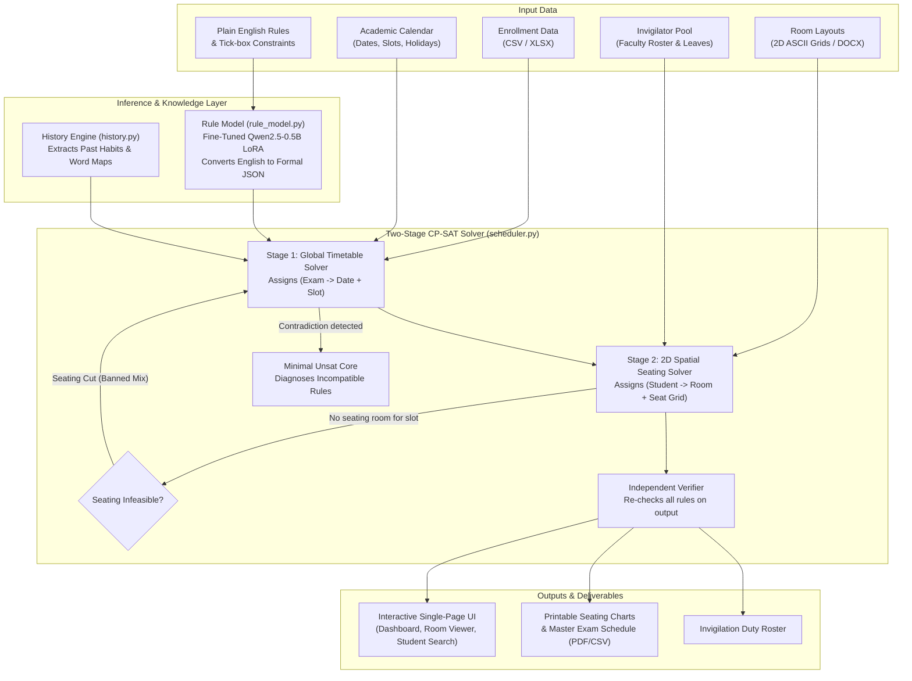

# Oliver: Autonomous University Exam Planner & Seating Optimizer

> **A local-first, privacy-preserving AI engine for automated university exam timetabling, 2D room-level seating allocation, and invigilation staffing.**
> Powered by Google OR-Tools CP-SAT constraint programming and a locally fine-tuned Qwen2.5-0.5B LoRA model. Zero external API calls. 100% offline.

---

## Table of Contents

- [Overview](#overview)
- [Key Features](#key-features)
- [System Architecture](#system-architecture)
  - [Two-Stage Solving Pipeline](#two-stage-solving-pipeline)
  - [Room Filling Guarantees](#room-filling-guarantees)
  - [Feedback Loops and Infeasible Cuts](#feedback-loops-and-infeasible-cuts)
  - [Minimal Unsatisfiable Core Diagnosis](#minimal-unsatisfiable-core-diagnosis)
- [2D Physical Room Layout Engine](#2d-physical-room-layout-engine)
  - [Layout Grid Syntax](#layout-grid-syntax)
  - [Cheating Prevention & Spatial Separation](#cheating-prevention--spatial-separation)
- [Constraint Vocabulary (VOCAB)](#constraint-vocabulary-vocab)
- [AI Natural Language Rule Reader (`rule_model.py`)](#ai-natural-language-rule-reader-rule_modelpy)
  - [Architecture & Extraction Strategy](#architecture--extraction-strategy)
  - [Training & Evaluation](#training--evaluation)
  - [Continuous Active Learning](#continuous-active-learning)
- [Historical Data Mining & Profile Extraction (`history.py`)](#historical-data-mining--profile-extraction-historypy)
- [Web Interface & Workflow](#web-interface--workflow)
  - [Step 1: Exam & Enrollment Ingestion](#step-1-exam--enrollment-ingestion)
  - [Step 2: Room Configuration & Layout Design](#step-2-room-configuration--layout-design)
  - [Step 3: Calendar, Rules & Learned Habits](#step-3-calendar-rules--learned-habits)
  - [Step 4: Interactive Schedule, Seating Maps & Export](#step-4-interactive-schedule-seating-maps--export)
  - [Room View & Plan Dashboard](#room-view--plan-dashboard)
- [Getting Started](#getting-started)
  - [Prerequisites](#prerequisites)
  - [Installation](#installation)
  - [Running the Application](#running-the-application)
- [Comprehensive Test Suite](#comprehensive-test-suite)
- [REST API Reference](#rest-api-reference)
- [Directory Structure](#directory-structure)
- [Privacy, Security & Offline Guarantee](#privacy-security--offline-guarantee)
- [License](#license)

---

## Overview

Scheduling university semester examinations is an NP-hard combinatorial optimization challenge with hundreds of competing physical, pedagogical, and administrative constraints:
- **Timetabling**: Preventing course clashes for enrolled students, balancing daily cognitive workload, respecting department-specific scheduling preferences, and enforcing gap days between difficult papers.
- **Seating Arrangement**: Assigning students to exact physical seats within non-uniform architectural rooms (amphitheaters, computer labs, tiered lecture halls), preventing same-course students from sitting adjacent to each other, and honoring room-mix limits.
- **Invigilation Duty**: Staffing qualified faculty members fairly across sessions and rooms while enforcing duty limits and availability windows.

**Oliver** automates this entire operational pipeline. It replaces brittle manual spreadsheets with an exact constraint programming engine (OR-Tools CP-SAT) paired with a local natural language processing model that interprets English rules entered by exam administrators.



---

## Key Features

1. **Two-Stage Constraint Optimization**:
   - **Global Timetable Optimization**: Simultaneously balances student exam spread over the full calendar duration, minimizing peak daily examination stress and eliminating exam double-bookings.
   - **Fine-Grained 2D Seating Allocation**: Seats each exam session seat-by-seat inside actual physical rooms, respecting architectural benches, aisles, and irregular rows.
2. **Cheating Prevention by Construction**:
   - Same-exam students are strictly prevented from sitting horizontally adjacent to each other (or front-to-back when enabled).
   - Configurable room-mixing bounds limit how many distinct course exams can share an individual room to prevent proctor confusion.
3. **Local Natural Language Rule Understanding**:
   - Administrators can type rules in plain English: *"Keep at least 2 days gap between Discrete Math and Data Structures"*, *"Do not schedule core engineering papers on Friday afternoon"*, or *"Reserve EB1-101 exclusively for accessibility students"*.
   - A fine-tuned local small language model (**Qwen2.5-0.5B-Instruct** with LoRA) translates free-form text directly into typed constraint objects.
4. **Automated Conflict Diagnosis (Minimal Unsatisfiable Core)**:
   - When an administrator inputs mutually exclusive rules (e.g., paper A before paper B, but paper B fixed on day 1), the solver doesn't just crash. It isolates the exact minimal conflicting rule subset and displays it in plain language.
5. **Historical Pattern Mining (`history.py`)**:
   - Ingests legacy Microsoft Word (`.docx`) seat-map templates and past examination PDFs.
   - Automatically learns historical university customs (e.g., which semesters sit morning vs. afternoon, standard capacity buffers, row spacing conventions).
6. **Invigilation Duty Allocation**:
   - Distributes proctoring duties evenly across faculty members, enforcing configurable student-to-proctor ratios and daily duty caps.
7. **Single-Page Application (SPA) Web Dashboard**:
   - Fully interactive frontend built with clean, reactive vanilla web standards:
     - 4-step wizard for configuring, solving, and inspecting plans.
     - Interactive 2D visual room layout editor.
     - Student seat lookup search engine.
     - CSS print-optimized outputs for notice-board seating sheets and admit-card generation.
8. **100% Local & Confidential**:
   - Student roll numbers, grades, and faculty records never leave your local infrastructure.

---

## System Architecture

The core solver engine lives in [`scheduler.py`](scheduler.py) and operates in two coordinated stages using Google OR-Tools CP-SAT.

### Two-Stage Solving Pipeline

```
           [ All Exams & Student Enrollments ]
                           │
                           ▼
             ┌───────────────────────────┐
             │ Stage 1: Timetable Solver │ ◄──────┐
             │   (Global CP-SAT Model)   │        │
             └─────────────┬─────────────┘        │
                           │                      │
             Candidate (Exam -> Slot) Map         │
                           │                      │
                           ▼                      │
             ┌───────────────────────────┐        │
             │  Stage 2: Seating Solver  │        │
             │   (Parallel Room Model)   │        │
             └─────────────┬─────────────┘        │
                           │                      │
                   Can all students be            │
                 spaced out in the rooms?         │
                      /          \                │
                   [Yes]        [No] ─────────────┘
                     │           Add Seating Cut:
                     ▼           forbid this exam subset
               Final Plan        from co-occurring in one slot
```

#### Stage 1: Timetabling (`solve_timetable`)
- Formulates a Boolean decision variable $x_{e,t} \in \{0, 1\}$ for every exam $e \in E$ and available time slot $t \in T$.
- **Hard Constraints**:
  - $\sum_{t \in T} x_{e,t} = 1 \quad \forall e \in E$ (Every exam scheduled exactly once).
  - For any student $s$, at most one of their registered exams can occur in any slot:
    $$\sum_{e \in \text{Exams}(s)} x_{e,t} \le 1 \quad \forall t \in T$$
  - Daily limit: Student sits at most $N$ exams per calendar day (default 2, configurable down to 1).
  - Physical capacity bounds: Total students scheduled in slot $t$ cannot exceed total usable room seats.
- **Objective Function (Soft Penalties)**:
  - Spread exams evenly across the calendar; avoid back-to-back papers on consecutive days.
  - Utilize the full exam period (from the first selected day to the last).
  - Respect administrator soft preferences (`prefer_early`, `prefer_late`, `prefer_slot`).
  - **Fill rooms completely** (see [Room Filling Guarantees](#room-filling-guarantees)): penalise seats that would stay empty because a big paper sits alone in its session.

#### Stage 2: Seating Allocation (`seat_slot`)
- For each time slot $t$, solves seating independently:
  1. **Room Assignment**: Allocates student counts per exam to available rooms (`allocate_rooms`). Both modes open the **fewest rooms** first; `compact` (default) then fills them one after another so only the last room opened has empty seats, `spread` shares students evenly over those same rooms (`room_use`).
  2. **Seat Placement**: Places students onto individual room seat coordinates (`place_in_room`), ensuring no two students taking the same exam share adjacent seats.
  3. **Roll Number Ordering**: Fills seats sequentially by roll number (`assign_rolls`), ensuring cohort groupings remain orderly and easy for invigilators to manage.

### Room Filling Guarantees

Same-exam students may not sit side by side, so a room holding only **one** paper can use only its *spaced* seats (roughly every other seat). The gaps fill only when a **different** paper shares the room, which is how the office's own past plans look: three or four papers mixed in every room.

An earlier version scheduled big papers alone in their own session. On the real end-term data, CC1101 (527 students) sat alone in 18 rooms with about a third of the seats empty, while the papers that could have filled those gaps were in other sessions. Across the whole period, **1,771 seats in opened rooms stayed empty**.

Stage 1 now estimates, for every session, the seats a lone paper would leave empty:

$$\text{empty}_t \ \ge\ \Big\lfloor n_e \cdot \tfrac{\text{usable}_t}{\text{spaced}_t} \Big\rfloor - \sum_{e'} n_{e'}\,x_{e',t} \qquad \text{whenever } x_{e,t}=1$$

and minimises `EMPTY_SEAT_WEIGHT × empty_t` (`scheduler.py`) alongside the spreading objectives. The solver therefore pairs big papers from cohorts that share no students in the same session, and their students interleave seat by seat.

| Real end-term data (1,201 students, 72 exams, 20 days) | Before | After |
| :--- | ---: | ---: |
| Empty seats in opened rooms (whole period) | 1,771 | 215 |
| Room-sessions to staff with invigilators | 161 | 127 |
| Students with more than one exam on a day | 0 | 0 |
| Rule violations | 0 | 0 |

The remaining empty seats are tiny sessions, such as one backlog student in a 32-seat room, that clash with every other session.

**Regression tests that keep these mistakes from coming back** (`test_scenarios.py`):

| Test | The mistake it catches |
| :--- | :--- |
| `t_rooms_filled_completely` | A big paper alone in a session, leaving its rooms half empty while other papers could fill them. The test fails on the old code: 96 empty seats in 4 rooms. |
| `t_no_mostly_empty_rooms` | `spread` once put about 10 students in each of 15 rooms instead of filling 3. |
| `t_room_use_spread` | `spread` opening more rooms than `compact`. |
| stress test (`extra_rooms`) | Any of 200 random universities opening more rooms than its students need. |

Every plan also lists its room findings in the UI (`room_checks`): rooms that aren't full because only one paper is in them, sessions with more than one partly-filled room, and a last room that is less than half full.

### Feedback Loops and Infeasible Cuts
If Stage 1 schedules a combination of exams in slot $t$ that cannot physically fit into the available rooms under spacing constraints (even though the sum of student counts is theoretically smaller than total raw seats), Stage 2 raises an infeasibility cut:
$$\sum_{e \in S} x_{e, t} \le |S| - 1$$
Stage 1 is re-executed with this cut incorporated. This loop runs until a valid timetable and seating plan are reached.

### Minimal Unsatisfiable Core Diagnosis
When constraints are over-constrained (e.g., student enrollment makes it impossible to schedule all papers without back-to-back clashes in a short calendar), the solver engages diagnostic mode (`diagnose=True`):
1. User constraints are attached to assumption literals in the CP-SAT model.
2. Upon infeasibility, `solver.SufficientAssumptionsForInfeasibility()` identifies the active conflict core.
3. `minimal_core()` iteratively eliminates non-essential rules one by one to present administrators with the exact minimal set of conflicting rules that cannot simultaneously hold.

---

## 2D Physical Room Layout Engine

University lecture rooms are rarely simple rectangular grids. They feature aisles, missing desk positions, tiered steps, and multi-seat wooden benches.

### Layout Grid Syntax

Oliver represents rooms as multiline ASCII strings (stored in [`rooms.json`](rooms.json)):

| Character | Meaning | Description |
| :---: | :--- | :--- |
| `S` | **Usable Seat** | An active desk/seat position capable of seating one student. |
| `x` | **Blocked Seat** | A physically existing seat marked unusable (broken desk, equipment, pillar obstruction). |
| `-` | **Bench Extension** | Widens the seat to its left by one column. Used to represent continuous benches or long tables. |
| ` ` | **Aisle / Gap** | Walkways, center aisles, or empty floor space that break physical adjacency. |

#### Example: Tiered Lecture Hall with Center Aisle
```text
SS-S SS-S
SS-S SS-S
SSS- SSS-
SSSS SSSS
```
- Row 1: Two 3-student benches separated by an aisle (`SS-S` and `SS-S`).
- Row 4: Four individual chairs on the left, four on the right.

#### Example: Computer Lab with Missing Workstations
```text
SxS SSS
SSS SxS
```
Seats marked `x` cannot be assigned, preventing students from being seated at malfunctioning terminals while preserving accurate seat indices (`R1-1`, `R1-2`, etc.).

### Cheating Prevention & Spatial Separation

The spatial solver computes adjacency graphs using `adjacent_pairs()`:
- **Side Adjacency**: Seats touching horizontally in the same row without an intervening aisle or blocked seat `x`.
- **Front-to-Back Adjacency**: Seats directly behind/in front of each other in adjacent rows whose column spans overlap.

By default, **students sitting the same exam paper are strictly forbidden from sharing side-by-side adjacency**. When room capacity is tight, administrators can toggle `allow_adjacent` for specific large exams or enable `adjacent_when_needed`.

---

## Constraint Vocabulary (VOCAB)

The solver understands 23 formal constraint types. All natural language rules or web form toggles map directly into this vocabulary:

| Constraint Type | Parameters | Nature | Description |
| :--- | :--- | :---: | :--- |
| `max_exams_per_day` | `n: int` | Hard | Maximum exams any single student may sit in a single calendar day (default: 2). |
| `no_back_to_back` | `hard: bool` | Hard / Soft | Prevents students from sitting exams in consecutive slots on the same day. |
| `min_gap_days` | `days: int, hard: bool, exams?: [code]` | Hard / Soft | Enforces at least `days` working days between exams for each student. |
| `holiday` | `dates: [YYYY-MM-DD]` | Hard | Blacklists specific calendar dates from having any exam sessions. |
| `day_slots` | `date: YYYY-MM-DD, slots: int` | Hard | Sets a custom slot count for a specific date (e.g., 1 slot on a half-day). |
| `fix_exam` | `exam: code, date?: ISO, slot?: int` | Hard | Pins an exam to a designated date and/or slot index. |
| `forbid_exam` | `exam: code, date?: ISO, slot?: int` | Hard | Forbids an exam from taking place on a specified date or slot. |
| `same_slot` | `exams: [code]` | Hard | Forces multiple courses to run concurrently (e.g., shared common paper). |
| `different_day` | `exams: [code]` | Hard | Guarantees that a specified group of exams are held on separate days. |
| `order` | `first: code, then: code` | Hard | Enforces that `first` must be held in an earlier slot than `then`. |
| `prefer_early` | `exams?: [code], largest?: int, weight?: int` | Soft | Optimizes the schedule to place these exams (or the $N$ largest) early in the period. |
| `prefer_late` | `exams?: [code], weight?: int` | Soft | Optimizes the schedule to place these exams toward the end of the period. |
| `prefer_slot` | `exams: [code], slot: int, weight?: int` | Soft | Biases exams toward a specific slot of the day (e.g., slot 1 for morning). |
| `max_exams_per_room`| `n: int` | Hard | Limits the maximum number of distinct exam courses placed in any single room. |
| `room_use` | `mode: "spread" \| "compact"` | Optimization | Both open the fewest rooms needed; `compact` (default) fills them one after another, `spread` shares students evenly among them. |
| `adjacent_when_needed` | none | Learned | Papers too big to space out in any session may sit side by side, as in past plans. |
| `room_fill` | `max_fraction: float, room?: id` | Hard | Restricts room occupancy to a percentage of total capacity (e.g., 0.85 = 85%). |
| `room_unavailable` | `room: id, date?: ISO, slot?: int` | Hard | Marks a specific room as unavailable during given dates or slots. |
| `seat_spacing` | `directions: ["side", "front"]` | Hard | Prohibits same-exam seating along specified geometric directions. |
| `allow_adjacent` | `exams: [code]` | Hard | Waives spatial separation for specified large cohorts. |
| `exam_rooms` | `exam: code, rooms: [id]` | Hard | Restricts an exam to run only in specified designated rooms. |
| `student_rooms` | `students: [roll], rooms: [id]` | Hard | Assigns specific students to designated rooms (e.g., accessibility needs). |
| `invigilation` | `per_students: int, min_per_room: int, max_per_day: int` | Hard | Defines proctor staffing rules per room and session. |

---

## AI Natural Language Rule Reader (`rule_model.py`)

Rather than forcing users to write JSON or learn query syntax, Oliver includes a local Small Language Model (SLM) pipeline in [`rule_model.py`](rule_model.py).

```
"Schedule Discrete Maths and Data Structures at least two days apart"
                               │
                               ▼
        ┌──────────────────────────────────────────────┐
        │       Local SLM (Qwen2.5-0.5B-Instruct)      │
        │       Fine-tuned via PEFT / LoRA             │
        └──────────────────────┬───────────────────────┘
                               │
                     Raw Output JSON:
        {"type": "min_gap_days", "exams": ["Discrete Maths", "Data Structures"], "days": 2}
                               │
                               ▼
        ┌──────────────────────────────────────────────┐
        │               Entity Resolver                │
        │  Matches course names, room IDs, and dates   │
        │     to exact codes from enrollment table     │
        └──────────────────────┬───────────────────────┘
                               │
                     Resolved Rule:
        {"type": "min_gap_days", "params": {"exams": ["CS1142", "CS1131"], "days": 2}}
```

### Architecture & Extraction Strategy
- **Base Model**: `Qwen/Qwen2.5-0.5B-Instruct` (~500M parameters). Lightweight enough to run inference on CPU or standard laptop GPUs.
- **De-coupled Entity Extraction**: The neural network only predicts the *rule type* and extracts the *verbatim string entities* (`"applied physics"`, `"next Monday"`, `"LT-1"`).
- **Fuzzy Resolution**: `resolve()` maps extracted text spans to canonical database codes using exact substring matching, date arithmetic, and normalized Levenshtein token distance. This means the model **never has to be retrained when course catalogs or room numbers change**.

### Training & Evaluation
1. **Synthetic Training Generation**: Generates 32,000+ realistic administrative variations combined with the university's actual course codes and room names.
2. **LoRA Fine-Tuning**: Trains in ~10 minutes on an NVIDIA RTX GPU (or CPU):
   ```bash
   .venv/bin/python rule_model.py train
   ```
3. **Out-of-Distribution Evaluation**: Evaluates on hand-written test sentences not present in training data:
   ```bash
   .venv/bin/python rule_model.py eval
   ```

### Continuous Active Learning
When an administrator edits or corrects a rule interpretation in the web UI, the correction is submitted to `POST /api/corrections` and appended to `corrections.jsonl`. These real-world administrative corrections are automatically included in subsequent fine-tuning runs.

---

## Historical Data Mining & Profile Extraction (`history.py`)

Universities develop unwritten scheduling habits over decades. Rather than requiring users to manually re-enter these preferences, [`history.py`](history.py) extracts knowledge directly from historical documents placed in `data/past/`:

1. **Word (.docx) Room Layout Extraction**:
   - Parses the actual floor plan seating grids in Word format (`.docx` tables with seat boundaries).
   - Automatically builds high-fidelity 2D layouts in `rooms.json`.
2. **PDF Seating Summary Parsing**:
   - Uses `pdftotext` to parse legacy seating tables and date sheets.
   - Extracts:
     - **Session Preferences**: Which academic semesters typically sit in Morning (Slot 1) vs. Afternoon (Slot 2).
     - **Room-Mix Habits**: Average and maximum distinct examination papers mixed per room.
     - **Adjacency Patterns**: Historical spacing protocols.
3. **Audit & Anomaly Reporting**:
   - Detects historical anomalies in university archives: duplicate student roll numbers in old plans, mismatch between published counts and actual roll lists, and instances where past plans exceeded room capacity.
4. **Generating the Learned Profile**:
   - Outputs `data/profile.json` and `data/history.json`.
   - In the web UI, these appear as one-click toggles under *"Learned from past exams"*.

---

## Web Interface & Workflow

Start the local server (`./start.sh`) and navigate to `http://localhost:8000`.

### Step 1: Exam & Enrollment Ingestion
- Choose examination type: **Mid-Semester** (typically 1 exam/day, morning slots) or **End-Semester** (2 exams/day, full-period spread).
- Upload an enrollment spreadsheet (`.xlsx`, `.csv`, `.tsv` in UTF-8, UTF-16, or CP-1252).
- Automatic column sniffer detects Roll Number, Subject Code, Course Name, Semester, and Subject Type.
- Review student roll count, filter cohorts, or click *"Try with sample data"* for an instant demo.

### Step 2: Room Configuration & Layout Design
- View all detected campus rooms, categorized by building (`EB1`, `EB2`, `IM`, `LT`, etc.).
- Inspect room capacities (total physical seats vs. spaced capacity).
- Click any room to open the **Interactive 2D Grid Editor**:
  - Click any seat to cycle its state (`S` usable $\leftrightarrow$ `x` blocked).
  - Add aisles, rows, and bench spans.
  - Drop `.docx` seat maps or Excel-saved CSV layouts directly onto the room list.
- Choose room allocation strategy:
  - **Spread**: Distributes students across all selected rooms.
  - **Compact**: Fills the minimum number of rooms required.

### Step 3: Calendar, Rules & Learned Habits
- Set exam start date, end date, and slot times (e.g., `09:30 - 12:30`, `14:00 - 17:00`).
- Mark holidays and weekend exclusions.
- Type free-form plain English rules into the AI prompt box and press **Interpret**.
- Toggle learned historical habits (morning/afternoon semester preferences, room mix caps).

### Step 4: Interactive Schedule, Seating Maps & Export
- Click **Generate Plan**. The CP-SAT solver runs in real time with live status updates.
- **Timetable View**: A full calendar matrix displaying daily sessions, courses scheduled, student volumes, and room allocations.
- **Room Seating Grid**: Visual diagram of every room seat-by-seat, with student roll numbers and color-coded exam tags.
- **Student Lookup**: Real-time search bar to look up any student's complete exam schedule, room assignments, and seat numbers.
- **Invigilator Roster**: Assigned proctors per room and slot.
- **Export**: One-click **Print to PDF** (notice-board format) and **Download CSV**.

### Room View & Plan Dashboard
- **Dashboard**: Access, re-open, compare, or delete previously solved plans stored in `data/plans/`.
- **Room View**: Dedicated view designed for building coordinators to inspect a single room across all sessions and print its physical door charts.

---

## Getting Started

### Prerequisites
- **Linux, macOS, or Windows WSL2**
- **Python 3.10+**
- **Poppler Utilities** (required for `pdftotext` in `history.py`):
  ```bash
  # Ubuntu / Debian
  sudo apt-get install -y poppler-utils

  # macOS (Homebrew)
  brew install poppler

  # Fedora / RHEL
  sudo dnf install -y poppler-utils
  ```

### Installation

1. Clone the repository:
   ```bash
   git clone https://github.com/yashmish18/oliver.git
   cd oliver
   ```

2. Create a virtual environment and activate it:
   ```bash
   python3 -m venv .venv
   source .venv/bin/activate
   ```

3. Install required Python packages:
   ```bash
   pip install -r requirements.txt
   ```
   Only `ortools`, `openpyxl` and `python-docx` are needed to solve. `torch`, `transformers`, `peft` and `accelerate` run the plain-English rule reader. `playwright` is used only by `test_ui.py`.

4. Train the rule reader once. The LoRA weights (`rule_model/`, about 45 MB) are not stored in git, and the **Interpret** button needs them:
   ```bash
   python rule_model.py train   # ~10 min on a laptop GPU, longer on CPU; downloads Qwen2.5-0.5B-Instruct once
   ```
   Tick boxes and the solver work without this step.

5. *(Optional)* Install Playwright browser binaries if running UI automated tests:
   ```bash
   playwright install chromium
   ```

6. *(Optional)* Ingest past exam data and initialize rooms:
   ```bash
   python history.py --replay
   ```

### Running the Application

Launch with the convenience script:
```bash
./start.sh
```
Or directly using the Python runtime:
```bash
.venv/bin/python server.py
```
Open **`http://localhost:8000`** in any modern web browser.

---

## Comprehensive Test Suite

Oliver includes three rigorous testing layers:

### 1. Scenario & Stress Tests (`test_scenarios.py`)
Generates hundreds of synthetic university topologies with irregular room architectures, multi-cohort backlogs, and tests every individual rule type to verify that constraints take effect:
```bash
.venv/bin/python test_scenarios.py 300
```

### 2. Real-World End-Term Stress Test (`test_scheduler.py`)
Executes an end-to-end solve on an actual university dataset (1,200+ students, 72 exams, 20-day examination window) with layout verification and history parsing:
```bash
.venv/bin/python test_scheduler.py
```

### 3. Headless UI Regression Test (`test_ui.py`)
Launches headless Chromium via Playwright, uploads enrollment files, verifies form validation, clicks through all wizard steps, exercises the room editor, and captures screenshots in `ui_shots/`:
```bash
# Ensure server.py is running in another terminal
.venv/bin/python test_ui.py
```

---

## REST API Reference

The built-in Python HTTP server (`server.py`) provides a clean JSON API:

| Endpoint | Method | Payload / Parameters | Description |
| :--- | :---: | :--- | :--- |
| `/` | `GET` | None | Serves the single-page application (`index.html`). |
| `/api/rooms` | `GET` | None | Retrieves all room definitions, layouts, and capacities. |
| `/api/rooms` | `POST` | `[{ id, layout, ... }]` | Updates or saves room configurations. |
| `/api/vocab` | `GET` | None | Returns the dictionary of supported constraint types and parameters. |
| `/api/plans` | `GET` | None | Returns metadata for all saved exam plans. |
| `/api/plans/{id}` | `GET` | None | Retrieves full details of a specific saved plan. |
| `/api/plans/{id}` | `DELETE`| None | Deletes a plan from storage. |
| `/api/table` | `POST` | `{ name: str, data: base64 }` | Parses an uploaded spreadsheet (`.xlsx` or `.csv`) into preview rows. |
| `/api/summary` | `POST` | `{ enrollment: str, calendar: obj }`| Analyzes enrollment: student count, exams, cohorts, and applicable habits. |
| `/api/interpret` | `POST` | `{ text: str, enrollment: str, rooms: list, calendar: obj }` | Translates natural language rules into structured constraint JSON. |
| `/api/solve` | `POST` | `{ enrollment, rooms, constraints, calendar, invigilators, time_limit }` | Triggers the Stage 1 & Stage 2 CP-SAT solver pipeline. |
| `/api/import` | `POST` | `{ files: [{ name, data }] }` | Ingests Word `.docx` seat maps or past PDFs into `data/past/`. |
| `/api/corrections` | `POST` | `[{ text, rules }]` | Records admin corrections to `corrections.jsonl` for model retraining. |
| `/samples/{file}` | `GET` | None | Serves bundled sample files (`enrollment_sample.csv`, rules, etc.). |

---

## Directory Structure

```text
oliver/
├── data/
│   ├── history.json           # Extracted historical examination database
│   ├── past/                  # Ingested legacy PDFs & Word .docx seat maps
│   ├── plans/                 # Saved examination plans (JSON)
│   └── profile.json           # Learned university operational habits & biases
├── samples/                   # Sample datasets for instant evaluation
│   ├── enrollment_sample.csv  # 260 students, 15 courses across cohorts
│   ├── enrollment_sample.xlsx # Excel formatted enrollment data
│   ├── invigilators_sample.csv# Faculty proctoring list
│   ├── make_samples.py        # Synthetic sample generator
│   └── rules_sample.txt       # Example English rules
├── history.py                 # PDF/Word parser & university habit learning engine
├── index.html                 # Reactive single-page web application
├── README.md                  # Comprehensive documentation
├── requirements.txt           # Python dependencies
├── rooms.json                 # Campus room inventory & 2D layout specifications
├── rule_model.py              # Fine-tuned Qwen2.5-0.5B LoRA rule parser
├── scheduler.py               # Two-stage OR-Tools CP-SAT scheduling & seating engine
├── server.py                  # Standalone HTTP & REST API server
├── start.sh                   # Application launcher script
├── test_scenarios.py          # Randomized scenario & edge-case test suite
├── test_scheduler.py          # Real-world end-to-end dataset solver test
└── test_ui.py                 # Playwright automated browser test suite
```

---

## Privacy, Security & Offline Guarantee

Oliver was specifically designed for educational institutions handling sensitive student and faculty data:
- **Zero Cloud Dependence**: The solvers (OR-Tools) and AI models (Hugging Face Transformers / PEFT) run entirely on local CPU/GPU hardware.
- **No Third-Party Telemetry**: No external API keys (OpenAI, Anthropic, Google Cloud) are needed or contacted.
- **FERPA / GDPR Friendly**: Student names, roll numbers, academic backlogs, and faculty records never leave your university's local perimeter.

---

## License

This project is open-source and available under the **MIT License**.
